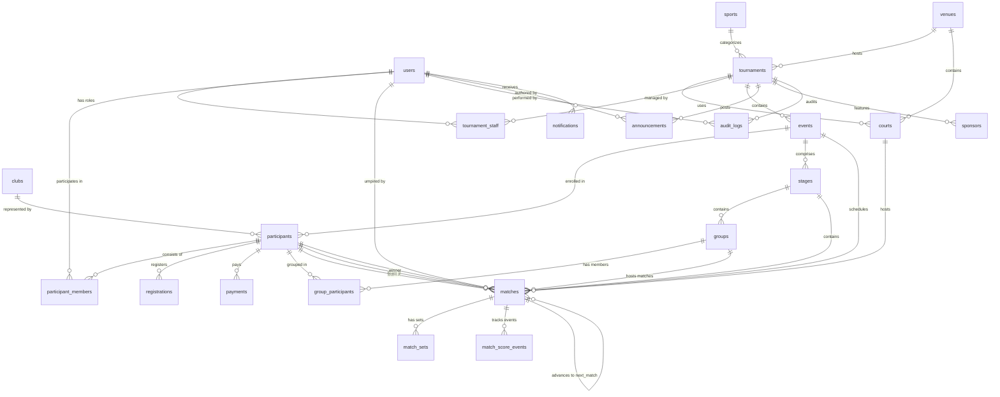

# Database Architecture & Entity-Relationship Design

## 1. Design Principles

1. **Relational Integrity**: Fully normalized relational schema with strict Foreign Keys and `ON DELETE` rules (primarily `RESTRICT` or `CASCADE` where child records are strictly owned).
2. **Historical Preservation via Snapshotting**: When athletes participate in tournaments, their display name, club snapshot, and partner records are copied into `participant_members.player_name_snapshot`. Later edits to a user's global profile will never alter the historical integrity of finished tournaments.
3. **Monetary Precision**: All financial fields (e.g. `entry_fee`, `amount`) use integer representation (cents/micros or fixed integer cents `BIGINT`) or PostgreSQL `DECIMAL(12, 2)` to avoid IEEE 754 floating-point inaccuracies.
4. **Time & Timezones**: All timestamps are persisted as UTC `TIMESTAMPTZ`. The tournament's local IANA timezone (`tournaments.timezone`, e.g., `Asia/Ho_Chi_Minh`) governs schedule display and day boundary calculations.
5. **Event-Sourced Scoring**: Individual scoring actions are recorded as discrete, append-only events in `match_score_events`, empowering robust undo operations, audit logging, and forensic playback.

---

## 2. Entity-Relationship Diagram (Mermaid)

---

## 3. Core Tables Specification

### 3.1. User & Identity

#### `users`
- `id`: `UUID` (PK, default `gen_random_uuid()`)
- `email`: `VARCHAR(255)` (Unique, Indexed)
- `phone`: `VARCHAR(50)` (Nullable, Indexed)
- `full_name`: `VARCHAR(255)` (Not Null)
- `password_hash`: `VARCHAR(255)` (Not Null)
- `avatar_url`: `TEXT` (Nullable)
- `role`: `VARCHAR(50)` (Enum: `SUPER_ADMIN`, `USER`, Default: `USER`)
- `status`: `VARCHAR(50)` (Enum: `ACTIVE`, `SUSPENDED`, `INACTIVE`, Default: `ACTIVE`)
- `created_at`: `TIMESTAMPTZ` (Default `NOW()`)
- `updated_at`: `TIMESTAMPTZ` (Default `NOW()`)

---

### 3.2. Master Data: Sports, Clubs, Venues, Courts

#### `sports`
- `id`: `UUID` (PK)
- `name`: `VARCHAR(100)` (Not Null)
- `code`: `VARCHAR(50)` (Unique, e.g. `BADMINTON`)
- `description`: `TEXT`
- `is_active`: `BOOLEAN` (Default `TRUE`)
- `created_at`: `TIMESTAMPTZ` (Default `NOW()`)

#### `clubs`
- `id`: `UUID` (PK)
- `name`: `VARCHAR(255)` (Not Null, Indexed)
- `code`: `VARCHAR(50)` (Nullable, e.g. `VNB`)
- `logo_url`: `TEXT`
- `description`: `TEXT`
- `contact_person`: `VARCHAR(255)`
- `contact_phone`: `VARCHAR(50)`
- `created_at`: `TIMESTAMPTZ` (Default `NOW()`)

#### `venues`
- `id`: `UUID` (PK)
- `name`: `VARCHAR(255)` (Not Null)
- `address`: `TEXT` (Not Null)
- `city`: `VARCHAR(100)` (Not Null)
- `country_code`: `VARCHAR(10)` (Default `'VN'`)
- `contact_phone`: `VARCHAR(50)`
- `description`: `TEXT`
- `created_at`: `TIMESTAMPTZ` (Default `NOW()`)

#### `courts`
- `id`: `UUID` (PK)
- `venue_id`: `UUID` (FK -> `venues.id`, Nullable)
- `tournament_id`: `UUID` (FK -> `tournaments.id`, On Delete Cascade)
- `name`: `VARCHAR(100)` (Not Null, e.g., 'Sân 1', 'Court A')
- `court_order`: `INTEGER` (Not Null, Default 1)
- `status`: `VARCHAR(50)` (Enum: `AVAILABLE`, `MAINTENANCE`, `OCCUPIED`, Default `AVAILABLE`)
- `created_at`: `TIMESTAMPTZ` (Default `NOW()`)

---

### 3.3. Tournaments & Staff

#### `tournaments`
- `id`: `UUID` (PK)
- `name`: `VARCHAR(255)` (Not Null)
- `slug`: `VARCHAR(255)` (Unique, Indexed)
- `sport_id`: `UUID` (FK -> `sports.id`)
- `venue_id`: `UUID` (FK -> `venues.id`, Nullable)
- `country_code`: `VARCHAR(10)` (Default `'VN'`)
- `timezone`: `VARCHAR(50)` (Default `'Asia/Ho_Chi_Minh'`)
- `contact_phone`: `VARCHAR(50)`
- `contact_email`: `VARCHAR(255)`
- `banner_url`: `TEXT`
- `logo_url`: `TEXT`
- `rule_content`: `TEXT` (Rich text HTML/Markdown)
- `rule_attachment_url`: `TEXT`
- `registration_open_at`: `TIMESTAMPTZ` (Not Null)
- `registration_close_at`: `TIMESTAMPTZ` (Not Null)
- `tournament_start_at`: `TIMESTAMPTZ` (Not Null)
- `tournament_end_at`: `TIMESTAMPTZ` (Not Null)
- `max_events_per_player`: `INTEGER` (Default 2)
- `match_interval_minutes`: `INTEGER` (Default 15)
- `default_match_duration_minutes`: `INTEGER` (Default 35)
- `total_courts`: `INTEGER` (Default 4)
- `status`: `VARCHAR(50)` (Enum: `DRAFT`, `PENDING_APPROVAL`, `REGISTRATION_OPEN`, `REGISTRATION_CLOSED`, `DRAW_COMPLETED`, `SCHEDULE_PUBLISHED`, `IN_PROGRESS`, `COMPLETED`, `CANCELLED`, `SUSPENDED`)
- `visibility`: `VARCHAR(50)` (Enum: `PUBLIC`, `PRIVATE`, `UNLISTED`, Default `PUBLIC`)
- `created_by`: `UUID` (FK -> `users.id`)
- `created_at`: `TIMESTAMPTZ` (Default `NOW()`)
- `updated_at`: `TIMESTAMPTZ` (Default `NOW()`)

#### `tournament_staff`
- `id`: `UUID` (PK)
- `tournament_id`: `UUID` (FK -> `tournaments.id`, On Delete Cascade)
- `user_id`: `UUID` (FK -> `users.id`, On Delete Cascade)
- `role`: `VARCHAR(50)` (Enum: `ORGANIZER`, `REFEREE`)
- `status`: `VARCHAR(50)` (Enum: `INVITED`, `ACCEPTED`, `REVOKED`, Default `ACCEPTED`)
- `invited_at`: `TIMESTAMPTZ` (Default `NOW()`)
- `accepted_at`: `TIMESTAMPTZ`
- **Unique Constraint**: `(tournament_id, user_id, role)`

---

### 3.4. Events & Registration Entities

#### `events`
- `id`: `UUID` (PK)
- `tournament_id`: `UUID` (FK -> `tournaments.id`, On Delete Cascade, Indexed)
- `name`: `VARCHAR(255)` (Not Null, e.g., 'Đôi Nam Nâng Cao', 'Đơn Nam Phong Trào')
- `group_type`: `VARCHAR(100)` (e.g. 'OPEN', 'ADVANCED', 'AMATEUR', 'AGE_30_PLUS')
- `play_type`: `VARCHAR(50)` (Enum: `SINGLE_MEN`, `SINGLE_WOMEN`, `DOUBLE_MEN`, `DOUBLE_WOMEN`, `DOUBLE_MIXED`)
- `format`: `VARCHAR(50)` (Enum: `KNOCKOUT`, `ROUND_ROBIN`, `ROUND_ROBIN_THEN_KNOCKOUT`)
- `entry_fee`: `DECIMAL(12, 2)` (Default 0.00)
- `currency`: `VARCHAR(10)` (Default `'VND'`)
- `max_participants`: `INTEGER` (Not Null, e.g. 16, 32, 64)
- `auto_pairing`: `BOOLEAN` (Default `FALSE`)
- `auto_draw`: `BOOLEAN` (Default `TRUE`)
- `has_third_place_match`: `BOOLEAN` (Default `TRUE`)
- `win_points`: `INTEGER` (Default 2)
- `lose_points`: `INTEGER` (Default 0)
- `default_sets_to_win`: `INTEGER` (Default 2)
- `is_registration_open`: `BOOLEAN` (Default `TRUE`)
- `status`: `VARCHAR(50)` (Enum: `DRAFT`, `OPEN`, `DRAWN`, `IN_PROGRESS`, `COMPLETED`, Default `DRAFT`)
- `created_at`: `TIMESTAMPTZ` (Default `NOW()`)
- `updated_at`: `TIMESTAMPTZ` (Default `NOW()`)

#### `participants`
- `id`: `UUID` (PK)
- `event_id`: `UUID` (FK -> `events.id`, On Delete Cascade, Indexed)
- `club_id`: `UUID` (FK -> `clubs.id`, Nullable, Indexed)
- `display_name`: `VARCHAR(255)` (Not Null, e.g. "Nguyễn Văn A / Trần Văn B")
- `participant_type`: `VARCHAR(20)` (Enum: `INDIVIDUAL`, `PAIR`)
- `is_seeded`: `BOOLEAN` (Default `FALSE`)
- `seed_number`: `INTEGER` (Nullable)
- `registration_status`: `VARCHAR(50)` (Enum: `PENDING`, `APPROVED`, `REJECTED`, `WAITLISTED`, `WITHDRAWN`, Default `PENDING`)
- `check_in_status`: `VARCHAR(50)` (Enum: `NOT_CHECKED_IN`, `CHECKED_IN`, Default `NOT_CHECKED_IN`)
- `created_at`: `TIMESTAMPTZ` (Default `NOW()`)
- `updated_at`: `TIMESTAMPTZ` (Default `NOW()`)
- **Constraint**: Unique `(event_id, seed_number)` when `seed_number IS NOT NULL`

#### `participant_members`
- `id`: `UUID` (PK)
- `participant_id`: `UUID` (FK -> `participants.id`, On Delete Cascade, Indexed)
- `user_id`: `UUID` (FK -> `users.id`, Nullable)
- `player_name_snapshot`: `VARCHAR(255)` (Not Null)
- `player_phone_snapshot`: `VARCHAR(50)` (Nullable)
- `member_order`: `INTEGER` (Default 1) — 1: First player, 2: Partner in doubles
- `invitation_status`: `VARCHAR(50)` (Enum: `ACCEPTED`, `PENDING_CONFIRMATION`, `DECLINED`, Default `ACCEPTED`)
- **Constraint**: Unique `(participant_id, member_order)`

#### `registrations`
- `id`: `UUID` (PK)
- `participant_id`: `UUID` (FK -> `participants.id`, On Delete Cascade, Unique)
- `submitted_by`: `UUID` (FK -> `users.id`)
- `status`: `VARCHAR(50)` (Enum: `PENDING`, `APPROVED`, `REJECTED`, `WAITLISTED`, `WITHDRAWN`)
- `rejection_reason`: `TEXT`
- `submitted_at`: `TIMESTAMPTZ` (Default `NOW()`)
- `reviewed_by`: `UUID` (FK -> `users.id`, Nullable)
- `reviewed_at`: `TIMESTAMPTZ`

#### `payments`
- `id`: `UUID` (PK)
- `participant_id`: `UUID` (FK -> `participants.id`, On Delete Cascade)
- `amount`: `DECIMAL(12, 2)` (Not Null)
- `currency`: `VARCHAR(10)` (Default `'VND'`)
- `payment_method`: `VARCHAR(50)` (e.g. `BANK_TRANSFER`, `CASH`, `ONLINE_GATEWAY`)
- `transaction_reference`: `VARCHAR(255)` (Nullable)
- `status`: `VARCHAR(50)` (Enum: `PENDING`, `PAID`, `FAILED`, `REFUNDED`, Default `PENDING`)
- `paid_at`: `TIMESTAMPTZ`
- `created_at`: `TIMESTAMPTZ` (Default `NOW()`)

---

### 3.5. Stages, Groups & Tournament Structure

#### `stages`
- `id`: `UUID` (PK)
- `event_id`: `UUID` (FK -> `events.id`, On Delete Cascade)
- `name`: `VARCHAR(100)` (Not Null, e.g. "Vòng Bảng", "Vòng Trực Tiếp")
- `stage_order`: `INTEGER` (Not Null, Default 1)
- `stage_type`: `VARCHAR(50)` (Enum: `GROUP_STAGE`, `KNOCKOUT_STAGE`)
- `status`: `VARCHAR(50)` (Enum: `PENDING`, `IN_PROGRESS`, `COMPLETED`, Default `PENDING`)

#### `groups`
- `id`: `UUID` (PK)
- `stage_id`: `UUID` (FK -> `stages.id`, On Delete Cascade)
- `name`: `VARCHAR(50)` (Not Null, e.g. "Bảng A", "Bảng B")
- `group_order`: `INTEGER` (Not Null, Default 1)

#### `group_participants`
- `id`: `UUID` (PK)
- `group_id`: `UUID` (FK -> `groups.id`, On Delete Cascade)
- `participant_id`: `UUID` (FK -> `participants.id`, On Delete Cascade)
- **Constraint**: Unique `(group_id, participant_id)`

---

### 3.6. Matches, Sets & Score Tracking

#### `matches`
- `id`: `UUID` (PK)
- `event_id`: `UUID` (FK -> `events.id`, On Delete Cascade, Indexed)
- `stage_id`: `UUID` (FK -> `stages.id`, Nullable, Indexed)
- `group_id`: `UUID` (FK -> `groups.id`, Nullable, Indexed)
- `court_id`: `UUID` (FK -> `courts.id`, Nullable, Indexed)
- `match_code`: `VARCHAR(50)` (Not Null, e.g. 'M-DM-01')
- `round_name`: `VARCHAR(100)` (e.g. 'Round of 16', 'Quarterfinal', 'Semifinal', 'Final', 'Vòng 1')
- `round_number`: `INTEGER` (Default 1)
- `bracket_position`: `INTEGER` (Nullable, position index in bracket canvas)
- `team_a_id`: `UUID` (FK -> `participants.id`, Nullable)
- `team_b_id`: `UUID` (FK -> `participants.id`, Nullable)
- `scheduled_start_time`: `TIMESTAMPTZ` (Nullable, Indexed)
- `estimated_duration_minutes`: `INTEGER` (Default 35)
- `actual_start_time`: `TIMESTAMPTZ`
- `actual_end_time`: `TIMESTAMPTZ`
- `is_time_locked`: `BOOLEAN` (Default `FALSE`)
- `referee_user_id`: `UUID` (FK -> `users.id`, Nullable, Indexed)
- `status`: `VARCHAR(50)` (Enum: `SCHEDULED`, `READY`, `IN_PROGRESS`, `COMPLETED`, `CANCELLED`, `WALKOVER`, Default `SCHEDULED`)
- `winner_id`: `UUID` (FK -> `participants.id`, Nullable)
- `next_match_id`: `UUID` (FK -> `matches.id`, Nullable)
- `next_match_slot`: `VARCHAR(10)` (Enum: `'TEAM_A'`, `'TEAM_B'`, Nullable)
- `version`: `INTEGER` (Default 1) — Optimistic locking & real-time sync monotonic sequence
- `created_at`: `TIMESTAMPTZ` (Default `NOW()`)
- `updated_at`: `TIMESTAMPTZ` (Default `NOW()`)

#### `match_sets`
- `id`: `UUID` (PK)
- `match_id`: `UUID` (FK -> `matches.id`, On Delete Cascade, Indexed)
- `set_number`: `INTEGER` (Not Null, 1, 2, or 3)
- `score_team_a`: `INTEGER` (Default 0, Check `>= 0`)
- `score_team_b`: `INTEGER` (Default 0, Check `>= 0`)
- `serving_team`: `VARCHAR(20)` (Enum: `'TEAM_A'`, `'TEAM_B'`, Nullable)
- `serving_player_id`: `UUID` (FK -> `participant_members.id`, Nullable)
- `winning_team_id`: `UUID` (FK -> `participants.id`, Nullable)
- `completed_at`: `TIMESTAMPTZ`
- **Constraint**: Unique `(match_id, set_number)`

#### `match_score_events`
- `id`: `UUID` (PK)
- `match_id`: `UUID` (FK -> `matches.id`, On Delete Cascade, Indexed)
- `set_number`: `INTEGER` (Not Null)
- `event_type`: `VARCHAR(50)` (Enum: `POINT_ADDED`, `POINT_REMOVED`, `SERVING_TEAM_CHANGED`, `COURT_SIDES_SWAPPED`, `SET_COMPLETED`, `MATCH_COMPLETED`, `SCORE_CORRECTED`)
- `team`: `VARCHAR(20)` (Enum: `'TEAM_A'`, `'TEAM_B'`, Nullable)
- `points_delta`: `INTEGER` (e.g. +1 or -1)
- `score_team_a`: `INTEGER` (Not Null)
- `score_team_b`: `INTEGER` (Not Null)
- `serving_team`: `VARCHAR(20)` (Enum: `'TEAM_A'`, `'TEAM_B'`, Nullable)
- `created_by`: `UUID` (FK -> `users.id`)
- `idempotency_key`: `VARCHAR(128)` (Unique, Indexed)
- `created_at`: `TIMESTAMPTZ` (Default `NOW()`)

---

### 3.7. Communications, Sponsors & Auditing

#### `announcements`
- `id`: `UUID` (PK)
- `tournament_id`: `UUID` (FK -> `tournaments.id`, On Delete Cascade)
- `title`: `VARCHAR(255)` (Not Null)
- `content`: `TEXT` (Not Null)
- `published_at`: `TIMESTAMPTZ` (Default `NOW()`)
- `created_by`: `UUID` (FK -> `users.id`)
- `created_at`: `TIMESTAMPTZ` (Default `NOW()`)

#### `sponsors`
- `id`: `UUID` (PK)
- `tournament_id`: `UUID` (FK -> `tournaments.id`, On Delete Cascade)
- `name`: `VARCHAR(255)` (Not Null)
- `sponsor_type`: `VARCHAR(50)` (e.g. 'TITLE', 'GOLD', 'SILVER', 'EQUIPMENT')
- `tier`: `INTEGER` (Default 1)
- `logo_url`: `TEXT` (Not Null)
- `website_url`: `TEXT`
- `display_order`: `INTEGER` (Default 1)

#### `notifications`
- `id`: `UUID` (PK)
- `user_id`: `UUID` (FK -> `users.id`, On Delete Cascade, Indexed)
- `tournament_id`: `UUID` (FK -> `tournaments.id`, Nullable)
- `title`: `VARCHAR(255)` (Not Null)
- `content`: `TEXT` (Not Null)
- `type`: `VARCHAR(50)` (e.g. `REGISTRATION_STATUS`, `MATCH_CALL`, `SCHEDULE_CHANGE`)
- `is_read`: `BOOLEAN` (Default `FALSE`)
- `created_at`: `TIMESTAMPTZ` (Default `NOW()`)

#### `audit_logs`
- `id`: `UUID` (PK)
- `user_id`: `UUID` (FK -> `users.id`, Nullable)
- `tournament_id`: `UUID` (FK -> `tournaments.id`, Nullable, Indexed)
- `action`: `VARCHAR(100)` (Not Null, e.g. `DRAW_GENERATED`, `SCORE_UPDATED`, `SCHEDULE_LOCKED`)
- `entity_type`: `VARCHAR(100)` (Not Null, e.g. `MATCH`, `PARTICIPANT`, `TOURNAMENT`)
- `entity_id`: `VARCHAR(255)` (Not Null)
- `old_value`: `JSONB`
- `new_value`: `JSONB`
- `ip_address`: `VARCHAR(45)`
- `created_at`: `TIMESTAMPTZ` (Default `NOW()`, Indexed)

